# ZooPass – ER diagram

Crow's-foot notation (Mermaid, rendered automatically on GitHub). To export a PNG for the report,
paste the block into https://mermaid.live and download it as `ER-diagram.png`.
Audit columns (`created_at`, `updated_at`, `created_by`, `updated_by`) and soft-delete columns
(`is_active`, `deleted_at`) are omitted from the boxes for readability.

```mermaid
erDiagram
    users ||--o{ orders : places
    users ||--o{ user_tokens : has
    users ||--o{ verifications : uploads
    users ||--o{ notifications : receives
    users ||--o{ check_ins : "scans (staff)"
    users ||--o{ payments : "receives cash (staff)"
    users ||--o{ audit_logs : performs
    users ||--o{ user_promotions : redeems
    promotions ||--o{ user_promotions : "redeemed in"
    promotions |o--o{ orders : "applied to"
    users ||--o{ user_saved_activities : plans
    activities ||--o{ user_saved_activities : "saved in"

    orders ||--|{ order_items : contains
    ticket_types |o--o{ order_items : "sold as"
    combos |o--o{ order_items : "sold as"
    orders ||--o| group_bookings : "group details"
    group_policies ||--o{ group_bookings : "priced by"
    group_bookings |o--o{ verifications : "proved by"
    orders |o--o{ verifications : "proved by"
    orders ||--o{ payments : "paid by"
    orders ||--o{ tickets : issues
    tickets ||--o{ check_ins : "used at"

    combos ||--o{ combo_zones : visits
    zones ||--o{ combo_zones : "visited by"
    zones ||--o{ animals : houses
    zones ||--o{ activities : hosts

    users {
        bigint id PK
        varchar email UK
        varchar password_hash
        varchar full_name
        varchar phone
        date date_of_birth
        varchar role "CUSTOMER|STAFF|MANAGER|ADMIN"
        boolean email_verified
        timestamptz last_login_at
    }
    user_tokens {
        bigint id PK
        bigint user_id FK
        varchar token_hash UK
        varchar purpose
        timestamptz expires_at
        timestamptz used_at
    }
    ticket_types {
        bigint id PK
        varchar code UK
        varchar name
        varchar category "GATE|TRAIN|TOUR|PASS|SERVICE"
        numeric price
        smallint min_height_cm
        smallint max_height_cm
        smallint min_quantity
        smallint entries_per_unit
        smallint validity_days
    }
    combos {
        bigint id PK
        varchar code UK
        varchar name
        numeric price
        smallint duration_minutes
        smallint min_participants
        smallint max_participants
        smallint min_age
    }
    zones {
        bigint id PK
        varchar code UK
        varchar name
        varchar zone_type
        varchar svg_path_id
        numeric map_x
        numeric map_y
    }
    animals {
        bigint id PK
        bigint zone_id FK
        varchar common_name
        varchar scientific_name
        varchar conservation_status
    }
    activities {
        bigint id PK
        bigint zone_id FK
        varchar title
        varchar activity_type
        time start_time
        time end_time
        smallint_array days_of_week
        smallint_array weeks_of_month
    }
    faqs {
        bigint id PK
        varchar category
        varchar question
        text answer
        tsvector search_vector
    }
    promotions {
        bigint id PK
        varchar code UK
        varchar discount_type
        numeric discount_value
        numeric min_order_amount
        int max_uses
        int used_count
        timestamptz valid_from
        timestamptz valid_to
    }
    group_policies {
        bigint id PK
        varchar group_category UK
        smallint min_group_size
        numeric visitor_discount_percent
        numeric beneficiary_discount_percent
        numeric staff_discount_percent
        numeric train_discount_percent
        smallint free_adult_per_students
        boolean requires_verification
        numeric deposit_percent
    }
    orders {
        bigint id PK
        varchar order_code UK
        bigint user_id FK
        bigint promotion_id FK
        varchar order_type "INDIVIDUAL|GROUP"
        varchar status
        date visit_date
        numeric subtotal
        numeric discount_amount
        numeric total_amount
        numeric paid_amount
        timestamptz payment_deadline
    }
    order_items {
        bigint id PK
        bigint order_id FK
        bigint ticket_type_id FK
        bigint combo_id FK
        varchar visitor_group
        int quantity
        numeric unit_price
        numeric discount_percent
        numeric line_total
    }
    group_bookings {
        bigint id PK
        bigint order_id FK,UK
        bigint group_policy_id FK
        varchar organization_name
        int total_visitors
        smallint guide_count
        varchar guide_language
        numeric deposit_amount
        varchar verification_status
        bigint reviewed_by FK
    }
    verifications {
        bigint id PK
        bigint uploaded_by FK
        bigint group_booking_id FK
        bigint order_id FK
        varchar document_type
        varchar file_url
        varchar mime_type
        int file_size_bytes
        varchar status
        bigint reviewer_id FK
    }
    payments {
        bigint id PK
        bigint order_id FK
        numeric amount
        varchar method "VNPAY|STRIPE|CASH"
        varchar purpose "FULL|DEPOSIT|REMAINING"
        varchar status
        varchar transaction_ref UK
        jsonb gateway_response
        bigint received_by FK
    }
    tickets {
        bigint id PK
        bigint order_id FK
        varchar qr_token UK
        int total_entries
        int used_entries
        varchar status
        timestamptz expires_at
    }
    check_ins {
        bigint id PK
        bigint ticket_id FK
        bigint staff_id FK
        smallint people_count "1..4"
        char gate "A|B|C|D"
        timestamptz scanned_at
    }
    combo_zones {
        bigint combo_id PK,FK
        bigint zone_id PK,FK
        smallint visit_order
    }
    user_promotions {
        bigint user_id PK,FK
        bigint promotion_id PK,FK
        bigint order_id FK
        timestamptz used_at
    }
    user_saved_activities {
        bigint user_id PK,FK
        bigint activity_id PK,FK
        date plan_date PK
    }
    notifications {
        bigint id PK
        bigint user_id FK
        varchar type
        varchar title
        boolean is_read
    }
    audit_logs {
        bigint id PK
        bigint actor_id FK
        varchar action
        varchar entity_type
        bigint entity_id
        jsonb old_value
        jsonb new_value
    }
    system_settings {
        varchar setting_key PK
        varchar setting_value
        varchar value_type
        boolean is_public
    }
```

